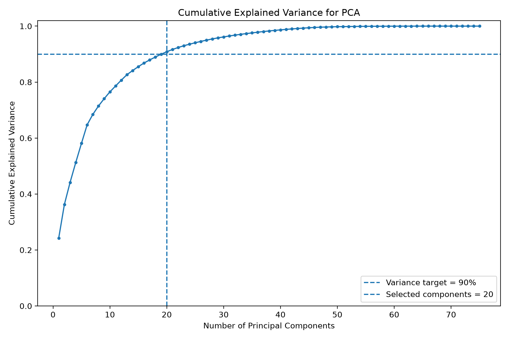
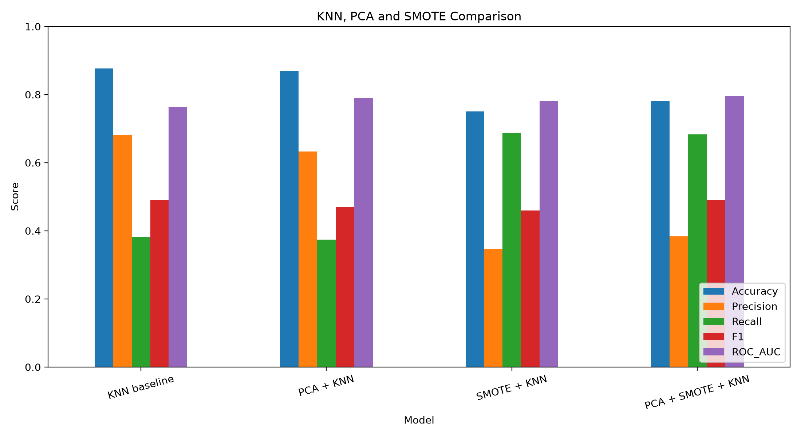
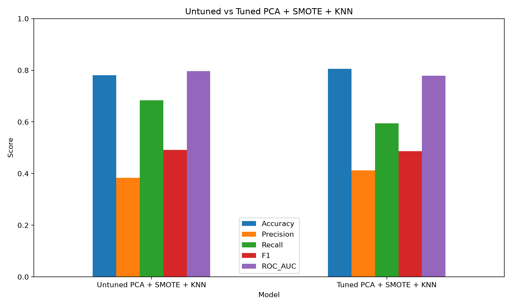

# Online Shoppers Purchase Prediction

Machine learning project for predicting whether an online shopping session will end with a purchase.

The project uses the **Online Shoppers Purchasing Intention Dataset** and compares several supervised classification algorithms. Because purchase sessions are much less common than non-purchase sessions, the analysis focuses not only on accuracy, but also on precision, recall, F1 score, and ROC AUC.

The project also examines class imbalance, feature importance, model tuning, decision-threshold adjustment, ensemble learning, dimensionality reduction with PCA, and oversampling with SMOTE.

---

## Project Goals

The project examines the following questions:

1. Can a purchase be predicted using information collected during an online shopping session?
2. Which machine learning algorithm performs best on this dataset?
3. How does class imbalance affect model evaluation?
4. Which session characteristics contribute most to the prediction?
5. Can parameter tuning improve the best-performing model?
6. Can dimensionality reduction improve KNN?
7. Can SMOTE improve the identification of purchase sessions?
8. Does combining PCA, SMOTE, and KNN produce a stronger imbalance-aware KNN model?
9. Can hyperparameter tuning improve the combined PCA, SMOTE, and KNN pipeline?

---

## Dataset

The dataset contains **12,330 online shopping sessions**.

Each row represents one user session. The target column is:

* `Revenue = True`: the session ended with a purchase.
* `Revenue = False`: the session did not end with a purchase.

The dataset is imbalanced:

* Approximately **84.5%** of the sessions did not end with a purchase.
* Approximately **15.5%** of the sessions ended with a purchase.

The input variables describe:

* The number and duration of administrative page visits.
* The number and duration of informational page visits.
* The number and duration of product-related page visits.
* Bounce rate.
* Exit rate.
* Page value.
* Proximity to a special day.
* Month.
* Visitor type.
* Browser.
* Operating system.
* Region.
* Traffic source.
* Whether the session occurred during a weekend.

---

## Project Structure

```text
Online_Shoppers_Purchase_Prediction_Project/
├── data/
│   └── online_shoppers_intention.csv
├── scripts/
│   ├── 01_eda.py
│   ├── 02_train_models.py
│   ├── 03_feature_importance.py
│   ├── 04_imbalance_analysis.py
│   ├── 05_random_forest_improvement.py
│   ├── 06_course_extensions.py
│   ├── 07_pca_knn_experiment.py
│   └── 08_tuned_pca_smote_knn.py
├── results/
│   ├── model_comparison.csv
│   ├── imbalance_comparison.csv
│   ├── improved_random_forest_results.csv
│   ├── course_extensions_adaboost_results.csv
│   ├── random_forest_feature_importance.csv
│   ├── pca_knn_comparison.csv
│   ├── pca_knn_dimension_summary.csv
│   ├── pca_knn_explained_variance.csv
│   ├── tuned_pca_smote_knn_results.csv
│   ├── tuned_pca_smote_knn_cv_results.csv
│   └── generated figures, reports, and confusion matrices
├── report/
│   └── final_report_hebrew.md
├── requirements.txt
└── README.md
```

---

## Analysis Process

### 1. Exploratory Data Analysis

The exploratory analysis examines:

* Dataset dimensions and column types.
* Missing values.
* Target-class distribution.
* Numerical variables grouped by purchase outcome.
* Purchase rates across categorical variables.
* Relationships between session characteristics and purchases.
* Distributions of important variables such as `PageValues`, `ExitRates`, and product-related activity.

### 2. Data Preparation

The target variable is separated from the input features.

The data is divided into training and test sets using a stratified split:

```python
train_test_split(
    X,
    y,
    test_size=0.20,
    random_state=42,
    stratify=y
)
```

Stratification preserves the original purchase-to-non-purchase ratio in both sets.

The preprocessing includes:

* Standardization of numerical variables using `StandardScaler`.
* One-hot encoding of categorical variables using `OneHotEncoder`.
* Handling unknown categories during prediction.
* Performing preprocessing inside a pipeline.

Some categorical variables are represented in the original dataset using numerical codes. These variables are treated as categories rather than continuous numerical measurements.

The use of pipelines prevents information from the test set from being used during preprocessing, dimensionality reduction, oversampling, or model training.

---

## Evaluation Metrics

Because the dataset is imbalanced, model quality is evaluated using several metrics.

### Accuracy

The proportion of all predictions that were correct.

Accuracy can be misleading for this dataset because a model that always predicts “no purchase” already achieves approximately 84.5% accuracy.

### Precision

Of all sessions predicted as purchases, the proportion that actually ended with a purchase.

High precision means that the model produces fewer false-positive purchase predictions.

### Recall

Of all sessions that actually ended with a purchase, the proportion detected by the model.

High recall means that the model misses fewer potential purchasers.

### F1 Score

The harmonic mean of precision and recall.

F1 was used as a central comparison metric because it balances the two measures for the minority purchase class.

### ROC AUC

Measures the model's ability to rank purchase sessions above non-purchase sessions across different classification thresholds.

---

## Baseline Model Comparison

The following algorithms were evaluated:

* Logistic Regression
* K-Nearest Neighbors
* Decision Tree
* Random Forest
* Linear Support Vector Machine

### Results

| Model               | Accuracy |  Precision |     Recall |         F1 |    ROC AUC |
| ------------------- | -------: | ---------: | ---------: | ---------: | ---------: |
| Random Forest       |   0.8901 |     0.6312 |     0.6990 | **0.6634** | **0.9191** |
| Logistic Regression |   0.8410 |     0.4913 | **0.7435** |     0.5917 |     0.8932 |
| SVM                 |   0.8390 |     0.4869 |     0.7304 |     0.5843 |     0.8879 |
| Decision Tree       |   0.8487 |     0.5117 |     0.5157 |     0.5137 |     0.7127 |
| KNN                 |   0.8767 | **0.6822** |     0.3822 |     0.4899 |     0.7633 |

Random Forest achieved the highest F1 score and ROC AUC.

Logistic Regression achieved the highest recall, but its lower precision produced more false-positive purchase predictions.

KNN achieved relatively high accuracy and precision, but its recall was very low. It missed a large proportion of the sessions that actually ended with a purchase.

---

## Class-Imbalance Analysis

A dummy classifier that always predicts “no purchase” achieves approximately **84.5% accuracy**, but its precision, recall, and F1 score for purchases are all zero.

This demonstrates why accuracy alone is not sufficient.

Random Forest was evaluated with and without class weighting.

| Version                 | Accuracy |  Precision |     Recall |         F1 |
| ----------------------- | -------: | ---------: | ---------: | ---------: |
| Without class balancing |   0.8982 | **0.7764** |     0.4817 |     0.5945 |
| With class balancing    |   0.8901 |     0.6312 | **0.6990** | **0.6634** |

Class balancing slightly reduced accuracy and precision, but substantially improved recall and F1.

The balanced model detected many more purchase sessions. This trade-off was considered beneficial because the project aims to identify purchase sessions rather than mainly predict the majority class.

---

## Feature Importance

Random Forest feature importance was used to examine which variables contributed most strongly to the model's predictions.

| Feature                 | Importance |
| ----------------------- | ---------: |
| PageValues              |     0.3326 |
| ExitRates               |     0.0911 |
| ProductRelated_Duration |     0.0789 |
| ProductRelated          |     0.0715 |
| BounceRates             |     0.0561 |
| Administrative_Duration |     0.0465 |
| Administrative          |     0.0395 |
| Month_Nov               |     0.0235 |

`PageValues` was the most important feature by a considerable margin.

The results also indicate that the following factors contributed to purchase prediction:

* Engagement with product-related pages.
* Exit and bounce behavior.
* Administrative-page activity.
* The timing of the session.

Feature importance describes how the trained model used the variables. It does not prove that a variable causes a purchase.

---

## Random Forest Improvement Attempt

A parameter search and decision-threshold experiment were performed to test whether the Random Forest result could be improved.

This experiment used a separate training, validation, and test procedure. Therefore, its baseline values differ slightly from the values in the main model-comparison table.

The models in the following table should be compared with each other rather than directly with the earlier table.

| Version                | Accuracy |  Precision |     Recall |         F1 |    ROC AUC |
| ---------------------- | -------: | ---------: | ---------: | ---------: | ---------: |
| Baseline Random Forest |   0.8869 | **0.6235** |     0.6806 | **0.6508** | **0.9149** |
| Tuned, threshold 0.50  |   0.8844 |     0.6147 |     0.6806 |     0.6460 |     0.9139 |
| Tuned, threshold 0.45  |   0.8796 |     0.5918 | **0.7173** |     0.6485 |     0.9139 |

The tuning attempt did not improve baseline F1 or ROC AUC.

Lowering the decision threshold from 0.50 to 0.45 increased recall, but it also produced more false-positive purchase predictions and reduced precision.

This experiment demonstrated that a more complex configuration does not necessarily outperform a reasonable baseline.

---

## AdaBoost Extension

AdaBoost was evaluated as an additional ensemble-learning method.

| Model    | Accuracy | Precision | Recall |     F1 | ROC AUC |
| -------- | -------: | --------: | -----: | -----: | ------: |
| AdaBoost |   0.8897 |    0.6618 | 0.5890 | 0.6233 |  0.9148 |

AdaBoost achieved good accuracy, precision, and ROC AUC.

However, its F1 score was lower than that of the balanced Random Forest because its recall was lower.

This result supports the conclusion that Random Forest provided the best overall balance between precision and recall.

---

## PCA Exploration

PCA was first used as a visualization tool.

The first two principal components explained:

* PC1: approximately 24.16% of the variance.
* PC2: approximately 12.01% of the variance.
* Combined: approximately 36.17% of the variance.

The two-dimensional projection did not show complete separation between purchase and non-purchase sessions.

This suggests that the classification problem cannot be described adequately using only two linear combinations of the processed features.

The two-component PCA experiment was used for visualization only. A larger number of components was later used in the predictive KNN experiment.

---

## PCA, SMOTE, and KNN Experiment

### Motivation

The baseline KNN model achieved:

* Precision: 0.6822
* Recall: 0.3822
* F1: 0.4899

The model was relatively precise when predicting purchases, but it failed to identify many actual purchase sessions.

Two possible causes were examined:

1. The high-dimensional feature space created after one-hot encoding.
2. The strong class imbalance between purchase and non-purchase sessions.

### PCA Component Selection

The original dataset contains 17 input features.

After numerical scaling and one-hot encoding, the processed training data contained **75 features**.

Instead of selecting an arbitrary number of components, PCA was configured to retain at least 90% of the cumulative explained variance:

```python
PCA(
    n_components=0.90,
    svd_solver="full"
)
```

PCA selected **20 components**, which explained approximately **90.845%** of the cumulative variance.

The feature space was therefore reduced from 75 features to 20 components while preserving most of its overall variance.

This predictive use of PCA differs from the earlier two-dimensional visualization:

* The visualization retained 2 components and approximately 36.17% of the variance.
* The predictive experiment retained 20 components and approximately 90.845% of the variance.

### Experimental Configurations

Four KNN configurations were evaluated:

1. Baseline KNN.
2. PCA followed by KNN.
3. SMOTE followed by KNN.
4. PCA followed by SMOTE and KNN.

All models used:

* The same stratified train-test split.
* `random_state=42`.
* Five nearest neighbors.
* Uniform neighbor weighting.
* The same preprocessing procedure.
* The same test set.

Keeping the KNN settings fixed allowed the experiment to isolate the effects of PCA and SMOTE.

### Combined Pipeline

The combined model followed this order:

```text
Preprocessing → PCA → SMOTE → KNN
```

All preprocessing, PCA fitting, and SMOTE oversampling were performed only on the training data.

The test data remained untouched until final evaluation.

This prevented data leakage.

### Results

| Model             |   Accuracy |  Precision |     Recall |         F1 |    ROC AUC |
| ----------------- | ---------: | ---------: | ---------: | ---------: | ---------: |
| KNN baseline      | **0.8767** | **0.6822** |     0.3822 |     0.4899 |     0.7633 |
| PCA + KNN         |     0.8694 |     0.6327 |     0.3743 |     0.4704 |     0.7899 |
| SMOTE + KNN       |     0.7506 |     0.3461 | **0.6859** |     0.4601 |     0.7810 |
| PCA + SMOTE + KNN |     0.7806 |     0.3833 |     0.6832 | **0.4911** | **0.7962** |

### Effect of PCA without SMOTE

PCA alone did not improve the main KNN classification metrics.

Compared with baseline KNN:

* Accuracy decreased from 0.8767 to 0.8694.
* Precision decreased from 0.6822 to 0.6327.
* Recall decreased from 0.3822 to 0.3743.
* F1 decreased from 0.4899 to 0.4704.
* ROC AUC increased from 0.7633 to 0.7899.

Therefore, dimensionality reduction alone did not improve the classification of purchase sessions.

One possible explanation is that PCA preserves directions with high overall variance, but those directions are not necessarily the most useful for separating purchase and non-purchase sessions.

PCA is unsupervised and does not use the target labels when selecting components.

### Effect of SMOTE

SMOTE substantially increased recall.

Recall increased from:

```text
0.3822 → 0.6859
```

The oversampled model identified a much larger proportion of the actual purchase sessions.

However, the increase in recall came at the cost of lower precision and accuracy.

The model predicted more sessions as purchases, increasing both:

* True positives.
* False positives.

This demonstrates that class balancing does not necessarily improve every metric. It changes the trade-off between missing actual purchases and incorrectly predicting purchases.

### Combined PCA and SMOTE

The combined PCA, SMOTE, and KNN pipeline achieved:

* Accuracy: 0.7806
* Precision: 0.3833
* Recall: 0.6832
* F1: 0.4911
* ROC AUC: 0.7962

Compared with SMOTE without PCA, the combined pipeline achieved:

* Higher accuracy.
* Higher precision.
* Higher F1.
* Higher ROC AUC.
* Almost the same recall.

This indicates that PCA created a more compact feature space in which SMOTE and KNN achieved a better balance than SMOTE and KNN without dimensionality reduction.

The combined pipeline was therefore the strongest imbalance-aware KNN configuration in the controlled comparison.





---

## Tuned PCA, SMOTE, and KNN Experiment

### Motivation

The previous experiment intentionally kept the KNN parameters fixed.

A final Grid Search experiment was conducted to examine whether the combined pipeline could be improved by tuning:

* The PCA variance target.
* The number of KNN neighbors.
* The neighbor-weighting method.

### Search Space

The following values were evaluated:

```python
parameter_grid = {
    "pca__n_components": [
        0.85,
        0.90,
        0.95
    ],
    "classifier__n_neighbors": [
        3,
        5,
        7,
        9,
        11,
        15
    ],
    "classifier__weights": [
        "uniform",
        "distance"
    ]
}
```

The search included:

```text
3 PCA targets × 6 neighbor values × 2 weighting methods
= 36 parameter combinations
```

Each configuration was evaluated using five-fold stratified cross-validation:

```text
36 combinations × 5 folds = 180 model fits
```

The primary model-selection metric was F1.

### Best Cross-Validation Configuration

Grid Search selected:

```text
PCA variance target: 0.85
Selected PCA components: 15
Number of neighbors: 3
Weights: distance
Mean cross-validation F1: 0.5355
```

The selected 15 components explained approximately **85.520%** of the cumulative variance.

### Test-Set Results

| Model                     |   Accuracy |  Precision |     Recall |         F1 |    ROC AUC |
| ------------------------- | ---------: | ---------: | ---------: | ---------: | ---------: |
| Untuned PCA + SMOTE + KNN |     0.7806 |     0.3833 | **0.6832** | **0.4911** | **0.7962** |
| Tuned PCA + SMOTE + KNN   | **0.8058** | **0.4120** |     0.5942 |     0.4866 |     0.7792 |

The tuned model improved:

* Accuracy.
* Precision.

However, it reduced:

* Recall.
* F1.
* ROC AUC.

The parameter search selected the configuration using cross-validation F1, but the selected model did not improve F1 on the untouched test set.

Therefore, the original untuned pipeline remained the preferred KNN configuration:

```text
PCA variance target: 90%
Selected PCA components: 20
Number of neighbors: 5
Weights: uniform
```

### Interpretation

The tuning result demonstrates that a higher cross-validation score does not guarantee better final test performance.

Some configurations with distance weighting achieved a training F1 score of 1.0. With distance-weighted KNN, a training observation may receive extremely high influence from itself because its distance is zero.

The large difference between training performance and validation or test performance suggests a risk of overfitting.

The tuned model was retained in the project because unsuccessful tuning attempts provide useful evidence about model generalization.



---

## Comparison of the Main Findings

The main experiments produced different precision-recall trade-offs.

### Balanced Random Forest

* Best overall F1.
* Best ROC AUC.
* Strong recall.
* Better precision than the oversampled KNN models.

### Logistic Regression and SVM

* High recall.
* Lower precision.
* Useful when missing a potential purchaser is considered especially costly.

### Baseline KNN

* High precision.
* Low recall.
* Missed many purchase sessions.

### PCA and SMOTE KNN

* Much higher recall than baseline KNN.
* Lower precision and accuracy.
* Useful for demonstrating the effect of class balancing.
* Did not outperform Random Forest overall.

### Tuned PCA and SMOTE KNN

* Higher accuracy and precision than the untuned version.
* Lower recall, F1, and ROC AUC.
* Did not improve the selected test-set metric.

---

## Main Challenges

### Imbalanced Target

Most sessions did not end with a purchase.

A model could achieve high accuracy without detecting the purchase class effectively.

This was addressed by:

* Comparing the models with a dummy baseline.
* Applying class weighting where supported.
* Applying SMOTE in the KNN experiment.
* Reporting precision, recall, F1, and ROC AUC.
* Comparing confusion matrices.

### Different Variable Types

The dataset combines:

* Continuous values.
* Count variables.
* Boolean variables.
* Text categories.
* Numerical category codes.

The preprocessing was separated into numerical and categorical transformations.

### High-Dimensional Encoded Data

One-hot encoding increased the number of features from 17 to 75.

PCA was tested as a method for reducing the dimensionality before applying KNN.

### Preventing Data Leakage

Preprocessing, PCA, and SMOTE can all introduce data leakage if they are applied before splitting the data.

They were therefore placed inside pipelines and fitted only using training data.

### Choosing an Evaluation Metric

Accuracy favored models that predicted the majority class.

F1 was used as a central metric because it balances precision and recall for the purchase class.

ROC AUC was also reported to evaluate ranking quality across classification thresholds.

### Improvement Did Not Guarantee Better Results

Neither the tuned Random Forest nor the tuned PCA, SMOTE, and KNN pipeline improved the main test-set F1 result.

These experiments were retained because unsuccessful improvement attempts provide important information about model stability, trade-offs, and generalization.

---

## Conclusions

Random Forest provided the strongest overall result for predicting purchase sessions.

The main conclusions are:

* Accuracy alone is misleading for an imbalanced dataset.
* A dummy majority-class classifier can achieve high accuracy while completely failing to identify purchases.
* Class balancing substantially improved the detection of purchase sessions.
* Random Forest provided the best balance between precision and recall.
* Random Forest achieved the highest F1 score and ROC AUC.
* `PageValues` was the strongest predictive feature.
* Product engagement, exit behavior, and bounce behavior also contributed to prediction.
* PCA reduced the processed feature space from 75 features to 20 components while retaining approximately 90.845% of the variance.
* PCA alone did not improve KNN classification.
* SMOTE substantially increased KNN recall.
* Combining PCA and SMOTE improved the imbalance-aware KNN result compared with SMOTE alone.
* The combined KNN pipeline did not outperform the balanced Random Forest.
* Grid Search did not improve the combined KNN test-set F1 score.
* More complex models or tuning procedures do not necessarily generalize better.
* Evaluation should consider the practical cost of missed purchases and false-positive purchase predictions.

The final selected model for the overall project is the **balanced Random Forest**.

The preferred KNN extension is the untuned:

```text
Preprocessing → PCA 90% → SMOTE → KNN
```

with:

```text
20 PCA components
5 neighbors
Uniform weights
```

---

## Running the Project

### 1. Create and activate a virtual environment

```bash
python3 -m venv .venv
source .venv/bin/activate
```

### 2. Install the required packages

```bash
python -m pip install --upgrade pip
python -m pip install -r requirements.txt
```

### 3. Run the scripts

Run the scripts from the project root directory in the following order:

```bash
python scripts/01_eda.py
python scripts/02_train_models.py
python scripts/03_feature_importance.py
python scripts/04_imbalance_analysis.py
python scripts/05_random_forest_improvement.py
python scripts/06_course_extensions.py
python scripts/07_pca_knn_experiment.py
python scripts/08_tuned_pca_smote_knn.py
```

The generated tables, reports, figures, and confusion matrices are saved in the `results/` directory.

---

## Main Result Files

### Model Comparison

```text
results/model_comparison.csv
```

### Class-Imbalance Analysis

```text
results/imbalance_comparison.csv
```

### Random Forest Improvement

```text
results/improved_random_forest_results.csv
```

### Feature Importance

```text
results/random_forest_feature_importance.csv
```

### AdaBoost and PCA Extensions

```text
results/course_extensions_adaboost_results.csv
results/pca_explained_variance.csv
```

### PCA, SMOTE, and KNN

```text
results/pca_knn_comparison.csv
results/pca_knn_dimension_summary.csv
results/pca_knn_explained_variance.csv
results/pca_knn_classification_reports.txt
results/pca_knn_cumulative_explained_variance.png
results/pca_knn_metric_comparison.png
```

### Tuned PCA, SMOTE, and KNN

```text
results/tuned_pca_smote_knn_results.csv
results/tuned_pca_smote_knn_cv_results.csv
results/tuned_pca_smote_knn_top10_cv_results.csv
results/tuned_pca_smote_knn_best_parameters.json
results/tuned_pca_smote_knn_metric_comparison.png
```

---

## Reproducibility Note

The repository contains the result files produced during the experiments.

The experiments use fixed random seeds where applicable, including:

```text
random_state = 42
```

Runtime values may vary between computers.

Small numerical differences may occur between versions of Python, scikit-learn, imbalanced-learn, NumPy, and pandas. The result files included in the repository preserve the outputs used in the project analysis.
