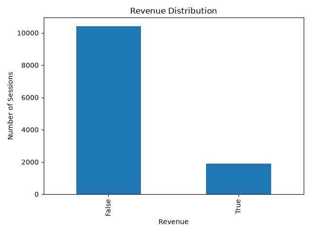
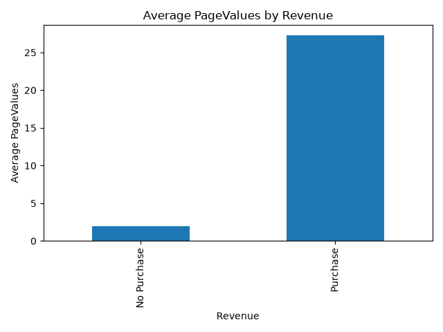
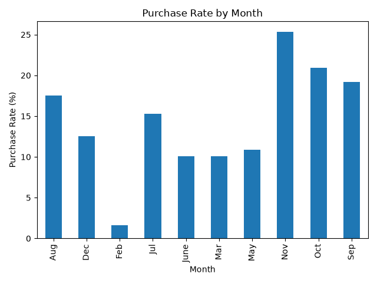
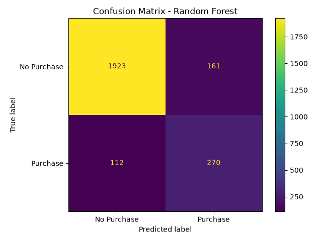

# פרויקט בלמידת מכונה: חיזוי כוונת רכישה באתר קניות אונליין

## 1. מבוא
בפרויקט זה נבחנה היכולת לחזות האם ביקור של משתמש באתר קניות אונליין יסתיים ברכישה או לא. הבעיה היא בעיית סיווג בינארי, משום שעמודת המטרה Revenue מקבלת שני ערכים אפשריים: רכישה או אי רכישה.

הדאטה כולל 12,330 ביקורים באתר קניות אונליין. כל שורה מייצגת ביקור אחד באתר, והמאפיינים מתארים את התנהגות המשתמש במהלך הביקור, למשל מספר הדפים שבהם ביקר, משך השהייה בדפים, שיעורי יציאה, סוג המשתמש, מקור התנועה, חודש הביקור ועוד.

## 2. מטרות ושאלות המחקר
בפרויקט נבדקו השאלות הבאות:

1. האם ניתן לחזות מראש האם מבקר באתר יבצע רכישה לפי ההתנהגות שלו באתר?
2. אילו מאפיינים משפיעים יותר על הסיכוי לרכישה?
3. איזה מודל למידת מכונה נותן את הביצועים הטובים ביותר עבור הבעיה?
4. כיצד חוסר האיזון בין רכישות לאי רכישות משפיע על ביצועי המודלים?

## 3. תיאור הדאטה
הדאטה כולל 18 עמודות: 17 עמודות קלט ועמודת מטרה אחת בשם Revenue. עמודת Revenue מציינת האם הביקור הסתיים ברכישה.

התפלגות עמודת המטרה:

- 10,422 ביקורים לא הסתיימו ברכישה.
- 1,908 ביקורים הסתיימו ברכישה.
- כלומר, רק כ-15.47% מהביקורים הסתיימו ברכישה.

מכאן ניתן לראות שהדאטה אינו מאוזן. רוב הדוגמאות שייכות למחלקת אי הרכישה, ורק מיעוט מהדוגמאות שייכות למחלקת הרכישה.

## 4. עיבוד מקדים
לפני אימון המודלים בוצע עיבוד מקדים לנתונים. העמודות המספריות עברו נרמול באמצעות StandardScaler, והעמודות הקטגוריאליות עברו קידוד באמצעות OneHotEncoder. בנוסף, הדאטה חולק לסט אימון וסט בדיקה ביחס של 80% לאימון ו-20% לבדיקה.

בחלוקה ל-Train ו-Test נעשה שימוש ב-stratify כדי לשמור על יחס דומה בין רכישות לאי רכישות גם בסט האימון וגם בסט הבדיקה. פעולה זו חשובה במיוחד כאשר הדאטה אינו מאוזן.

## 5. המודלים שנבדקו
בפרויקט נבדקו חמישה מודלים של למידת מכונה:

- Logistic Regression
- KNN
- Decision Tree
- Random Forest
- SVM

המודלים נבחרו כדי להשוות בין מודלים פשוטים יחסית לבין מודלים מורכבים יותר. Logistic Regression שימש כמודל בסיסי, בעוד Random Forest מאפשר ללמוד קשרים מורכבים יותר בין המאפיינים.

## 6. מדדי הערכה
מכיוון שהדאטה אינו מאוזן, Accuracy לבדו אינו מספיק להערכת איכות המודל. מודל יכול לקבל Accuracy גבוה גם אם הוא כמעט תמיד מנבא שאין רכישה. לכן נבדקו גם המדדים Precision, Recall, F1-score ו-ROC AUC.

פירוש המדדים:

- Accuracy: אחוז התחזיות הנכונות מתוך כלל הדוגמאות.
- Precision: מתוך כל הדוגמאות שהמודל חזה כרכישה, כמה באמת היו רכישה.
- Recall: מתוך כל הרכישות האמיתיות, כמה המודל הצליח לזהות.
- F1-score: מדד משולב בין Precision ו-Recall.
- ROC AUC: מדד כללי ליכולת ההפרדה של המודל בין שתי המחלקות.

## 7. תוצאות השוואת המודלים
טבלת התוצאות שהתקבלה:

| Model | Accuracy | Precision | Recall | F1 | ROC AUC |
|---|---:|---:|---:|---:|---:|
| Random Forest | 0.8893 | 0.6265 | 0.7068 | 0.6642 | 0.9225 |
| Logistic Regression | 0.8500 | 0.5107 | 0.7487 | 0.6072 | 0.8962 |
| SVM | 0.8487 | 0.5082 | 0.7304 | 0.5994 | 0.8931 |
| Decision Tree | 0.8532 | 0.5282 | 0.4895 | 0.5082 | 0.7047 |
| KNN | 0.8731 | 0.6456 | 0.4005 | 0.4943 | 0.7818 |

מתוך התוצאות ניתן לראות כי Random Forest היה המודל המוביל לפי מדד F1. מדד זה חשוב במיוחד בפרויקט משום שהדאטה אינו מאוזן, ורק חלק קטן יחסית מהביקורים מסתיים ברכישה. לכן לא מספיק לבדוק רק את אחוז הדיוק הכללי, אלא חשוב לבדוק עד כמה המודל מצליח לזהות בפועל את מחלקת הרכישה.

Random Forest הגיע ל-F1 הגבוה ביותר, כלומר הוא הצליח לשמור על איזון טוב יחסית בין Precision לבין Recall. מצד אחד, הוא לא סימן יותר מדי ביקורים כרכישה באופן שגוי, ומצד שני הוא הצליח לזהות חלק משמעותי מהרכישות האמיתיות.

Logistic Regression ו-SVM קיבלו Recall גבוה יותר מ-Random Forest, כלומר הם הצליחו לזהות יותר מהרכישות האמיתיות. עם זאת, ה-Precision שלהם היה נמוך יותר, ולכן הם יצרו יותר תחזיות שגויות של רכישה. כתוצאה מכך, ה-F1 שלהם היה נמוך יותר מזה של Random Forest.

KNN קיבל Accuracy יחסית גבוה, אך Recall נמוך. כלומר, למרות שהוא הצליח לסווג נכון הרבה דוגמאות באופן כללי, הוא פספס חלק גדול מהרכישות. לכן הוא פחות מתאים לבעיה שבה חשוב לזהות רכישות.

Decision Tree קיבל ביצועים נמוכים יותר ביחס ל-Random Forest. הסיבה לכך היא שעץ החלטה יחיד נוטה להיות פחות יציב, בעוד Random Forest משלב מספר רב של עצים ולכן מצליח להכליל טוב יותר.

## 8. השפעת חוסר האיזון בדאטה

מכיוון שרק כ-15.47% מהביקורים הסתיימו ברכישה, הדאטה אינו מאוזן. מצב כזה עלול לגרום למודלים להעדיף את מחלקת הרוב, כלומר לחזות ברוב המקרים שלא תהיה רכישה.

כדי לבדוק את ההשפעה של חוסר האיזון, הושוו מודלים רגילים למודלים שהוגדרו עם טיפול באיזון המחלקות, למשל באמצעות class_weight="balanced".

התוצאה הבולטת ביותר היא שמודל Dummy, שחוזה תמיד את המחלקה הנפוצה ביותר, קיבל Accuracy של בערך 84.5%, אך Precision, Recall ו-F1 שלו עבור רכישה היו 0. כלומר, למרות שהדיוק הכללי נראה גבוה, המודל לא באמת למד לזהות רכישות בכלל.

מכאן ניתן להסיק ש-Accuracy לבדו אינו מדד מתאים לבעיה זו. בפרויקט כזה חשוב יותר להסתכל על Recall ו-F1, משום שהם מתמקדים ביכולת לזהות את המחלקה החשובה — ביקורים שמסתיימים ברכישה.

בהשוואה בין מודלים מאוזנים ולא מאוזנים ניתן לראות שטיפול בחוסר איזון שיפר משמעותית את ה-Recall בחלק מהמודלים. לדוגמה, Logistic Regression balanced הגיע ל-Recall גבוה בהרבה מהגרסה הלא מאוזנת. המשמעות היא שהמודל המאוזן הצליח לזהות יותר רכישות אמיתיות, גם אם המחיר היה ירידה מסוימת ב-Precision.

גם ב-Random Forest ניתן לראות שהגרסה המאוזנת נתנה F1 גבוה יותר מהגרסה הלא מאוזנת. לכן, עבור הבעיה שנבדקה, טיפול בחוסר איזון תרם לביצועים טובים יותר במדדים החשובים.

## 9. חשיבות המאפיינים

נבדקה גם חשיבות המאפיינים במודל Random Forest. המאפיין החשוב ביותר היה PageValues, כלומר הערך המשוער של הדפים שבהם המשתמש ביקר במהלך הסשן. מאפיין זה היה משמעותי במיוחד לחיזוי רכישה.

מאפיינים חשובים נוספים היו ExitRates, ProductRelated_Duration, ProductRelated ו-BounceRates. כלומר, ההתנהגות של המשתמש באתר — כמה זמן הוא שהה בדפי מוצר, כמה דפי מוצר הוא ראה, ומה שיעורי היציאה שלו — משפיעה מאוד על הסיכוי שיבצע רכישה.

ממצא זה הגיוני מבחינה עסקית: משתמש שנמצא זמן רב יותר בדפי מוצר, עובר בין מוצרים ומגיע לדפים בעלי ערך גבוה יותר, כנראה נמצא בשלב מתקדם יותר בתהליך הקנייה. לעומת זאת, שיעורי יציאה או נטישה גבוהים עשויים להעיד על משתמש שפחות קרוב לביצוע רכישה.

## 10. שיפור Random Forest

לאחר שנמצא כי Random Forest הוא המודל המוביל, בוצע ניסיון לשפר אותו באמצעות Hyperparameter Tuning ו-Threshold Tuning.

ב-Hyperparameter Tuning נבדקו שילובים שונים של פרמטרים עבור Random Forest, כגון מספר העצים, עומק העצים, מספר הדוגמאות המינימלי בעלה וסוג האיזון בין המחלקות. בנוסף, בוצע Threshold Tuning כדי לבדוק האם שינוי סף ההחלטה מ-0.5 לערך אחר יכול לשפר את מדד F1.

למרות שהתהליך מקצועי וחשוב, התוצאות הראו שהמודל המשופר לא הצליח לעקוף את התוצאה הטובה ביותר מההשוואה הראשית. המודל המקורי של Random Forest קיבל F1 של כ-0.6642, בעוד המודלים לאחר הכיוונון קיבלו F1 מעט נמוך יותר.

מכאן ניתן להסיק שלא כל ניסיון לשיפור פרמטרים בהכרח משפר את התוצאה הסופית. לפעמים מודל פשוט יותר עם פרמטרים סבירים מצליח להכליל טוב יותר על סט הבדיקה. עם זאת, עצם ביצוע הכיוונון מחזק את העבודה, משום שהוא מראה שנבדקה אפשרות לשיפור בצורה שיטתית ולא הסתפקנו בהרצה אחת בלבד.

## 11. ניתוח ראשוני של הנתונים

לפני אימון המודלים בוצע ניתוח ראשוני של הנתונים כדי להבין את מבנה הדאטה ואת הקשרים האפשריים בין המאפיינים לבין עמודת המטרה Revenue.

השלב הראשון היה בדיקת התפלגות עמודת המטרה. נמצא כי קיימים הרבה יותר ביקורים שלא הסתיימו ברכישה מאשר ביקורים שכן הסתיימו ברכישה. כלומר, הדאטה אינו מאוזן. מצב זה חשוב מאוד, משום שהוא משפיע על בחירת מדדי ההערכה ועל האופן שבו מפרשים את ביצועי המודלים.

בנוסף, נבדקו ממוצעי המאפיינים המספריים עבור שתי הקבוצות: ביקורים שהסתיימו ברכישה וביקורים שלא הסתיימו ברכישה. מהבדיקה ניתן לראות כי קיימים הבדלים בין שתי הקבוצות, בעיקר במאפיינים כמו PageValues, ProductRelated_Duration, ProductRelated, BounceRates ו-ExitRates.

אחד הממצאים הבולטים הוא ש-PageValues גבוה יותר בממוצע עבור ביקורים שהסתיימו ברכישה. ממצא זה הגיוני, משום שמשתמשים שמגיעים לדפים בעלי ערך גבוה יותר באתר כנראה קרובים יותר לביצוע רכישה.

נבדקו גם מאפיינים קטגוריאליים כמו Month, VisitorType, Weekend ו-TrafficType. ניתוח זה מאפשר להבין האם יש הבדלים בשיעור הרכישות בין חודשים שונים, בין משתמשים חוזרים למשתמשים חדשים, ובין ביקורים באמצע שבוע לעומת סוף שבוע.

דוגמאות לגרפים שנוצרו במהלך הניתוח הראשוני:

## 12. ניתוח מטריצות בלבול

בנוסף למדדים המספריים, נבדקו גם מטריצות בלבול עבור המודלים השונים. מטריצת בלבול מאפשרת לראות לא רק כמה תחזיות היו נכונות, אלא גם אילו סוגי טעויות המודל ביצע.

בבעיה זו קיימים ארבעה מצבים עיקריים:

- True Negative: המודל חזה שלא תהיה רכישה, ובאמת לא הייתה רכישה.
- True Positive: המודל חזה שתהיה רכישה, ובאמת הייתה רכישה.
- False Positive: המודל חזה שתהיה רכישה, אבל בפועל לא הייתה רכישה.
- False Negative: המודל חזה שלא תהיה רכישה, אבל בפועל כן הייתה רכישה.

בפרויקט זה חשוב במיוחד לשים לב ל-False Negative, משום שמדובר במקרים שבהם המודל מפספס משתמשים שבפועל ביצעו רכישה. מבחינה עסקית, פספוס כזה יכול להיות משמעותי, כי המערכת לא מזהה משתמש שיש לו פוטנציאל גבוה לקנייה.

מצד שני, גם False Positive חשובים, משום שהם מייצגים מקרים שבהם המודל מסמן משתמש כמי שכנראה יבצע רכישה, למרות שבפועל הוא לא קונה. לכן יש צורך באיזון בין Precision לבין Recall.

Random Forest נתן את האיזון הטוב ביותר בין סוגי הטעויות, ולכן הוא נבחר כמודל המוביל בפרויקט.

דוגמה למטריצת הבלבול של Random Forest:

## 13. מגבלות העבודה ועבודה עתידית

למרות שהתוצאות שהתקבלו טובות יחסית, קיימות כמה מגבלות לפרויקט.

ראשית, הדאטה מבוסס על ביקורים באתר, אך לא בהכרח כולל מידע מלא על המשתמשים עצמם. לדוגמה, אין מידע מפורט על היסטוריית רכישות קודמת, מחיר המוצרים, מוצרים שנוספו לעגלה, מבצעים שהיו באותו זמן או פרטים דמוגרפיים על המשתמשים.

שנית, הדאטה אינו מאוזן. רוב הביקורים לא הסתיימו ברכישה, ולכן יש צורך להתייחס בזהירות למדד Accuracy. בפרויקט נעשה שימוש במדדים נוספים כמו Precision, Recall ו-F1, אך עדיין חוסר האיזון משפיע על הקושי של המודלים לזהות רכישות.

שלישית, נבדקו מספר מודלים קלאסיים של למידת מכונה, אך לא נבדקו מודלים מתקדמים יותר כמו XGBoost או LightGBM, שיכולים לעיתים להגיע לתוצאות טובות במיוחד בנתונים טבלאיים.

בעבודה עתידית ניתן להרחיב את הפרויקט בכמה כיוונים:

- לבדוק מודלים נוספים כמו XGBoost, LightGBM או CatBoost.
- להשתמש בשיטות איזון נוספות כמו SMOTE.
- לבצע כיוונון פרמטרים רחב יותר.
- לשלב מידע נוסף על המשתמשים, המוצרים או היסטוריית הקניות.
- לבדוק האם ניתן לשפר את ביצועי המודל באמצעות יצירת מאפיינים חדשים מתוך המאפיינים הקיימים.

## 14. מסקנות

בפרויקט זה נבדקה היכולת לחזות האם ביקור באתר קניות אונליין יסתיים ברכישה. הבעיה הוגדרה כבעיית סיווג בינארי, כאשר המטרה הייתה לחזות את ערך העמודה Revenue.

המסקנה המרכזית היא שניתן לחזות כוונת רכישה ברמה טובה יחסית לפי נתוני התנהגות של המשתמש באתר. המודל הטוב ביותר היה Random Forest, שהגיע לערך F1 הגבוה ביותר מבין המודלים שנבדקו.

בנוסף, נמצא שחוסר האיזון בדאטה משפיע מאוד על הערכת המודלים. Accuracy לבדו עלול להטעות, משום שמודל יכול לקבל דיוק גבוה גם אם הוא כמעט תמיד חוזה שאין רכישה. לכן בפרויקט זה הושם דגש על Precision, Recall ו-F1.

נמצא גם כי המאפיינים החשובים ביותר קשורים להתנהגות המשתמש באתר, במיוחד PageValues, משך השהייה בדפי מוצר, מספר דפי המוצר ושיעורי יציאה. ממצאים אלה מראים שהתנהגות המשתמש במהלך הביקור באתר יכולה לספק מידע משמעותי על הסיכוי שלו לבצע רכישה.

לסיכום, Random Forest היה המודל המתאים ביותר עבור משימה זו, בעיקר משום שהוא הצליח להתמודד טוב יחסית עם קשרים מורכבים בין המאפיינים ולשמור על איזון טוב בין זיהוי רכישות לבין הימנעות מתחזיות שגויות.
